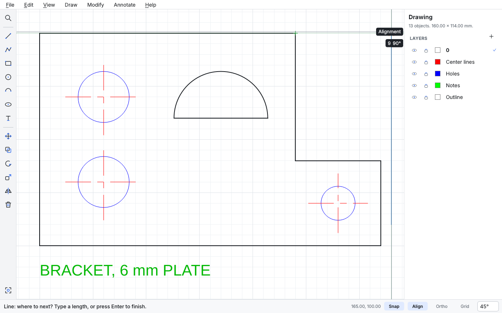

# DraftWorx

**A lightweight, offline 2D CAD program that's simple to learn and exceptionally good at drafting.** Windows and Linux. Free and open source (GPL-3.0-or-later).

Not more features than AutoCAD. Just everyday drafting that's easier: snaps that find the point you meant without a settings dialog, typing a length wherever you are,
trimming the bit in the way, one Dimension tool that reads what you point at, and DXF files that come back undamaged.

> **Status: under construction.** You can draw, snap, select, trim, offset, fillet and otherwise change things, dimension and hatch them, make and place blocks with fields to fill in, put the drawing on a sheet with a title block, print it or make a PDF to scale, and open and save DXF without damaging it. Nobody has used it by hand yet. See [the roadmap](docs/ROADMAP.md).



Copyright © 2026 Nate Robertson. No accounts, telemetry, advertisements or feature limits.

## Try it

A build for Windows or Linux is made on request: *Run workflow* on the [Build packages](https://github.com/nrobertson152/DraftWorx/actions/workflows/packages.yml)
page (it takes write access to the repository). About three minutes later, both are under *Artifacts* on the run's page for a day, for
anyone signed in to GitHub. Unpack yours and run `draftworx-gui` in the folder. Nothing to install, not even Python. Windows may say it
protected your PC, because the build isn't signed: *More info*, then *Run anyway*. These are builds to try, not releases.

Or with Python 3.13:

```sh
python -m pip install "draftworx @ git+https://github.com/nrobertson152/DraftWorx"
draftworx-gui
```

Type `L` and Enter to draw a line. Type a length and Enter. Pause on a corner to line up with it. Ctrl+K finds anything.

## Read more

- [How snapping behaves](docs/SNAPPING.md)

- [Architecture and decisions](docs/ARCHITECTURE.md)
- [Roadmap](docs/ROADMAP.md)
- [What existing CAD programs teach](docs/RESEARCH.md)
- [The file format](docs/FILE_FORMAT.md)
- [The `draftworx` command, for other programs](docs/COMMAND_LINE.md)
- [Known limitations](docs/KNOWN_LIMITATIONS.md)

## Works with the family

| Program | What DraftWorx does with it |
|---|---|
| **[RevisionWorx](https://github.com/nrobertson152/RevisionWorx)** | The status strip says what RevisionWorx says about the drawing, in its words ("DWG-1 rev B · Released · checked out by you"), with the one next step as a button: *Check out* or *Check in…*. Checking in saves first, and can take the drawing's parts list along as a BOM next to it. *File ▸ RevisionWorx* also undoes a check-out (keeping the file or putting the revision back) and puts a drawing that isn't controlled yet into a project. A drawing someone else has checked out isn't saved over. |
| **[OpenMeridian](https://github.com/nrobertson152/OpenMeridian)** | The parts list that blocks with part numbers make reaches it through RevisionWorx: checked in as a BOM, released there, and imported by OpenMeridian like any released BOM. |
| **[OpenSchematix](https://github.com/nrobertson152/OpenSchematix)** | DXF both ways: what it exports opens here, and what's saved here, R12 or later, opens there. |

None of them is needed to run DraftWorx. It reaches them only through their documented files and command lines, and finds RevisionWorx on the `PATH` (or set `REVISIONWORX_CLI` to its `revisionworx` program). Without it, nothing about it shows.

## Development

Python 3.13 and PySide6. See `AGENTS.md` for the rules and commands.
